# Mini-Redis 设计文档

这份文档带你用 Java 从零写一个迷你版 Redis。

**怎么读：**

| 部分 | 讲什么 | 适合什么时候读 |
|---|---|---|
| 第 0 节 | Redis 是什么、解决什么问题、为什么能解决 | 开工前，先读这一节 |
| 第 1–3 节 | 术语、功能说明书、每个命令的详细行为 | 写代码和写测试时反复查 |
| 第 4–5 节 | 程序怎么分层、每个模块怎么设计 | 动手写某个模块之前 |
| 第 6–7 节 | 分几步写、怎么测试 | 安排进度时 |
| 第 8–10 节 | 知识点对照、和真 Redis 的差异、分工 | 写完自查时 |

---

## 0. 从问题开始：为什么需要 Redis

这一节不讲代码。先弄清楚 Redis 要解决的问题，后面每个设计决定才有依据：它为什么存在内存里，为什么是单线程，为什么要写 AOF 文件，为什么 key 会过期。

### 0.1 一个具体的场景

假设你在做一个电商网站，商品详情页上有商品名、价格、库存，还有"已有 12345 人浏览"。这些数据存在 MySQL 数据库里，数据库把数据存在磁盘上。

用户每打开一次详情页，后台程序（Java 写的）就要做这几件事：

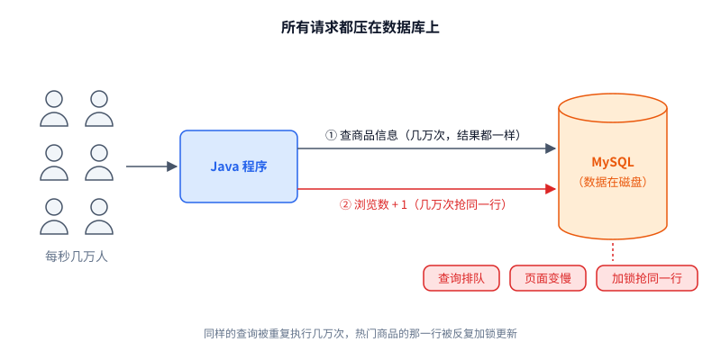

用的人少的时候没问题。到了大促，每秒几万人同时打开同一个商品页，问题就来了：

1. **数据库扛不住。** 每次打开页面都要查一次、写一次数据库。同一个商品的信息明明没变，却被重复查了几万遍。
2. **页面变慢。** 一次数据库查询通常要几毫秒到几十毫秒。数据库忙的时候请求排队，用户等好几秒。
3. **"浏览数 + 1"抢成一团。** 几万个请求同时改同一行数据，数据库要加锁，一个一个排队改。

问题的根源是：**所有请求都压在磁盘上的数据库上**，而磁盘很慢。

> **大白话：** 人一多，所有人都挤到同一个"仓库"（数据库）门口取货，而仓库取货又慢，于是大家一起排长队。

### 0.2 磁盘到底有多慢

把计算机里各种操作的耗时放在一起比较（数量级，不同硬件有差异）：

| 操作 | 大约耗时 | 换算成"人类时间"（把 1 纳秒当 1 秒） |
|---|---|---|
| 读一次内存 | 100 纳秒 | 1 分多钟 |
| SSD 随机读一次 | 0.1 毫秒 | 1 天 |
| 同机房网络往返一次 | 0.5 毫秒 | 6 天 |
| 机械硬盘随机读一次 | 10 毫秒 | 4 个月 |
| 一次普通的数据库查询（含解析 SQL、查索引、读磁盘） | 几毫秒～几十毫秒 | 几个月～一年 |


结论很直接：**内存比磁盘快几千到几万倍。** 如果热门数据放在内存里，大部分请求就不用碰数据库了。

> **大白话：** 从内存拿东西像从口袋里掏，从数据库拿像跑一趟仓库。常用的东西放口袋里，就不用老跑仓库。

### 0.3 第一个想法：在 Java 程序里放一个 HashMap

最简单的办法：在 Java 程序里开一个 `HashMap`，查过一次的商品就存进去，下次直接从 map 里取。

```java
Map<String, String> cache = new HashMap<>();

String getProduct(String id) {
    String p = cache.get(id);
    if (p == null) {                 // map 里没有，才去查数据库
        p = queryMySQL(id);
        cache.put(id, p);
    }
    return p;
}
```

这种做法叫**缓存**：把慢的地方的数据，复制一份放到快的地方。

一台机器时它能用，但真实的网站不会只有一台机器。为了扛住几万人，通常会同时运行很多个一模一样的 Java 程序，前面放一个负载均衡器把请求分给它们：

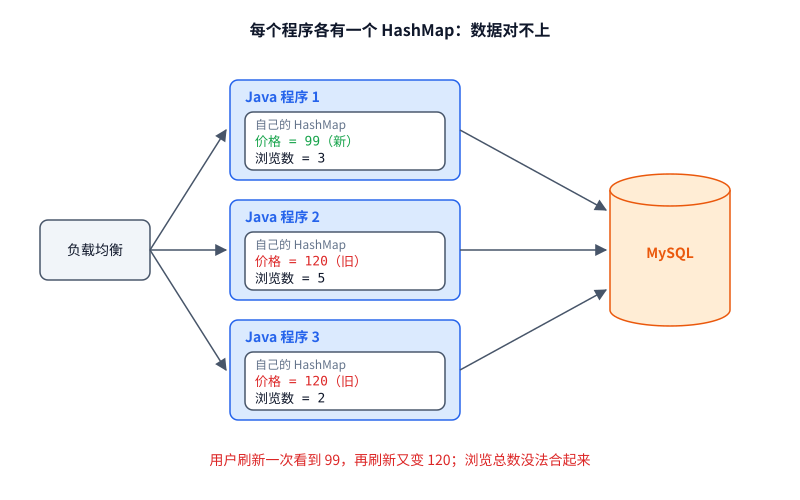

这时 HashMap 方案就出问题了：

| 问题 | 说明 |
|---|---|
| 数据不一致 | 管理员改了价格，只有一台机器的 map 被更新，用户刷新一次可能看到新价格，再刷新又是旧价格 |
| 计数不准 | 每台机器各数各的浏览数，没法合成一个总数 |
| 重启就丢 | 程序一重启，map 清空，所有请求瞬间又全部打到数据库 |
| 浪费内存 | 同一份商品数据在每台机器上各存一份 |

根本原因是：**这块内存是每个程序私有的，别的程序看不到。**

> **大白话：** 每个店员都在自己口袋里记一份价格表。老板改价只通知了一个人，其他人报的还是旧价。

### 0.4 Redis 的思路：把 HashMap 单独拿出来，变成一个服务

既然问题出在"内存是私有的"，那就把这个 HashMap 从 Java 程序里拿出来，单独运行成一个程序，大家都通过网络去访问它：

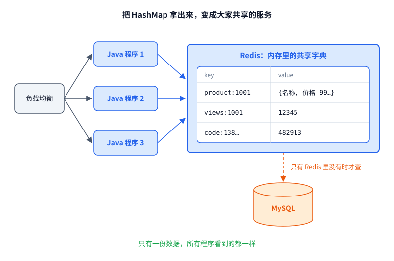

这就是 **Redis**（REmote DIctionary Server，远程字典服务）。它本质上就是：

> **一个通过网络访问的、数据放在内存里的 key-value 字典。**

所有 Java 程序都通过网络发一行命令给它，比如 `GET product:1001`，它从内存里查到值，再通过网络返回。读商品详情的流程变成：

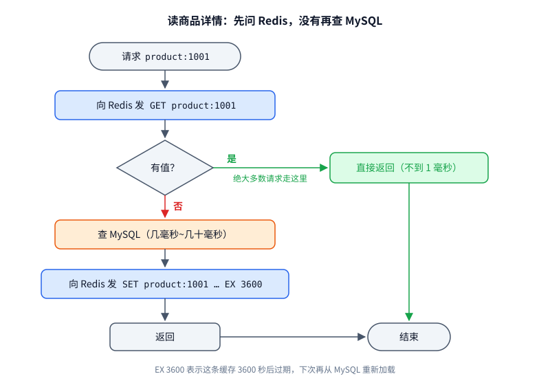

回头看 0.3 的四个问题：

| 问题 | Redis 怎么解决 |
|---|---|
| 数据不一致 | 只有一份数据，所有程序看到的都一样 |
| 计数不准 | 所有程序都发 `INCR views:1001`，Redis 统一加 1，总数自然准 |
| 重启就丢 | Java 程序重启不影响 Redis；Redis 自己重启，靠持久化恢复（见 0.6） |
| 浪费内存 | 数据只存一份 |

> **大白话：** 不让每个店员各记一份了，在店中间挂一块大家共用的白板。谁都去白板上查、去白板上改，大家看到的永远一样。白板上没有的，才去仓库拿，拿回来顺手写到白板上。

### 0.5 为什么 Redis 能这么快

单机 Redis 每秒可以处理十万次左右的简单命令。原因有四个，后三个正是你要在这个项目里亲手实现的：

| 原因 | 说明 | 本项目对应 |
|---|---|---|
| 数据在内存里 | 查一次只是内存访问，没有磁盘 IO | `MyHashMap` 存在 Java 堆里 |
| 数据结构简单 | 哈希表按 key 查找是 O(1)，不像 SQL 要解析语句、走索引、做查询计划 | 5.3 手写哈希表 |
| 单线程执行命令 | 所有命令排队，一个线程依次执行。没有锁，也没有线程切换的开销。内存操作本来就快，CPU 不是瓶颈，瓶颈在网络 | 4.2 事件循环 |
| 一个线程同时服务所有连接 | 借助操作系统的 epoll 机制，一个线程同时盯着成千上万个连接，哪个有数据就处理哪个，不用为每个连接开一个线程 | 4.2 事件循环 |

"单线程"还有一个附带的好处：**每条命令都是原子的**。三台 Java 程序同时发 `INCR views:1001`，Redis 一条一条执行，不会出现两个请求同时读到 100、都写回 101 的情况。这正好解决了 0.1 里"浏览数 + 1 抢成一团"的问题。

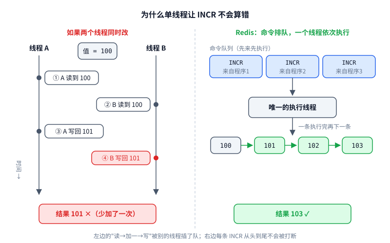

> **大白话：** Redis 快，是因为东西都在手边（内存）、找东西的方法简单（哈希表）、只有一个人干活所以不用互相等（单线程）。一个人干活还有个好处：事情一件一件做，不会两个人同时改同一个数改乱。

### 0.6 新问题一：内存断电就没了

数据放在内存里，Redis 进程一退出（重启、崩溃、断电），数据就全没了。缓存丢了还能从 MySQL 重新加载，但像浏览数这种只存在 Redis 里的数据就真丢了。

Redis 的解决办法之一叫 **AOF**（Append Only File，只追加文件）：每执行成功一条修改数据的命令，就把这条命令追加到磁盘文件的末尾。重启时从头把这个文件里的命令再执行一遍，内存就恢复了。

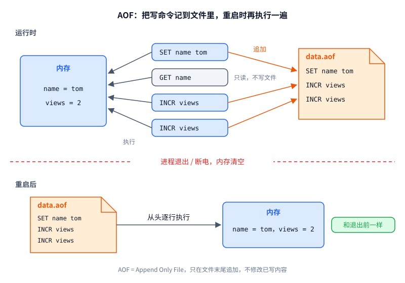

你可能会问：每条命令都写磁盘，那不又变慢了？不会，因为：

- **只写不读。** 平时查数据只走内存，磁盘只在重启时读一次。
- **只往末尾追加。** 磁盘最慢的是随机读写（磁头要来回找位置），顺序追加要快得多。
- **只记写命令。** 大多数网站读远多于写，`GET` 不进文件。

> **大白话：** 白板一断电就被擦干净了。所以每改一次白板，就在本子上记一笔"做了什么"。重启后照着本子从头再做一遍，白板就恢复原样了。只往本子最后一页写，所以很快。

### 0.7 新问题二：内存很贵，装不下所有数据

服务器内存通常是几十 GB，磁盘可以是几十 TB。不可能把所有数据都放进 Redis，而且很多数据只在一段时间内有用。

Redis 的办法是**过期时间（TTL）**：存数据时告诉 Redis "这个 key 只保留 N 秒"，时间到了自动删除。

```
SET code:13800000000 "482913" EX 300     # 短信验证码，5 分钟后自动失效
SET product:1001 "{...}" EX 3600         # 商品缓存，1 小时后过期，下次访问再从 MySQL 加载新的
```

过期还顺便解决了缓存的"数据变旧"问题：就算 MySQL 里的价格改了而缓存没更新，最多一小时后缓存过期，也会重新加载到新价格。

> **大白话：** 白板就那么大，所以写上去的东西可以注明"N 秒后擦掉"。验证码 5 分钟后自动作废，缓存 1 小时后自动刷新。

### 0.8 不只是字符串：值可以是列表

如果值只能是字符串，有些需求就很别扭。比如"最新 10 条评论"：存成一个大字符串的话，每来一条新评论都得把整串取出来、在 Java 里解析、插入、再整串写回。三台程序同时这么干，还会互相覆盖。

所以 Redis 的值可以是几种不同的类型，每种类型配一组专门的命令，直接在 Redis 里完成操作。本项目做其中最常用的两种：

| 类型 | 像 Java 里的 | 典型用途 | 命令举例 |
|---|---|---|---|
| string | `String` | 缓存、验证码、计数器 | `SET` `GET` `INCR` |
| list | `ArrayList<String>`（两头都能进出） | 最新消息列表、简单的任务队列 | `LPUSH` `LPOP` `LRANGE` |

"最新 10 条评论"变成：

```
LPUSH comments:1001 "这个好用"      # 新评论放到最前面
LRANGE comments:1001 0 9           # 取最前面的 10 条
```

一条命令，原子完成，不用在 Java 里搬来搬去。

（真 Redis 还有 hash、set、sorted set 等类型，本项目不做。）

> **大白话：** 白板上不只能写一句话，也能写一个"排队名单"。往名单两头加人、从头上叫人，都直接在白板上做，不用抄下来改完再写回去。

### 0.9 先玩一下真 Redis

写之前先用一用，心里会有底。macOS 上：

```
brew install redis        # 安装
redis-server              # 终端 A：启动服务端，默认端口 6379
redis-cli                 # 终端 B：启动客户端
```

在 `redis-cli` 里试试：

```
127.0.0.1:6379> SET name tom
OK
127.0.0.1:6379> GET name
"tom"
127.0.0.1:6379> INCR views
(integer) 1
127.0.0.1:6379> SET code 1234 EX 10
OK
127.0.0.1:6379> TTL code
(integer) 8
127.0.0.1:6379> GET code          # 10 秒后再试
(nil)
127.0.0.1:6379> RPUSH list a b c
(integer) 3
127.0.0.1:6379> LRANGE list 0 -1
1) "a"
2) "b"
3) "c"
```

你要写的 Mini-Redis，就是让同样的命令在你自己的程序上得到一模一样的输出。

> **大白话：** 先装个真的玩一玩，看看它长什么样。你的目标就是做一个"山寨版"，输入同样的命令，屏幕上显示一模一样的结果。

### 0.10 Mini-Redis 做什么

| 真 Redis 的能力 | 解决的问题 | Mini-Redis | 你会练到 |
|---|---|---|---|
| 网络服务，多个客户端共享 | 0.3 的数据不一致 | 做（网络部分由我封装） | 接口、回调 |
| 内存里的 key-value 字典 | 0.2 的磁盘太慢 | 做，**手写哈希表**，不用 `HashMap` | 数组、类、封装 |
| string / list 两种值 | 0.8 | 做 | 继承、多态、抽象类 |
| 单线程执行命令 | 0.5 的原子性和速度 | 做（事件循环由我封装） | 你的代码可以按单线程写 |
| AOF 持久化 | 0.6 断电丢数据 | 做 | 字符串处理、异常 |
| 过期时间 | 0.7 内存装不下 | 做 | `long` 时间戳、分支 |
| 和 redis-cli 一样的显示和报错 | 让你能拿真 Redis 对照 | 做 | `StringBuilder`、自定义异常 |
| 集群、主从复制、hash/set 等类型 | 更大规模的问题 | 不做 | — |

分工：

- **框架层（我写）**：网络、文件读写、命令行引号解析。你只调用，不用看懂内部。
- **业务层（你写）**：命令、数据结构、过期、持久化逻辑、异常、客户端交互，约占全部代码的 80%。

端口用 6380 而不是 Redis 默认的 6379，这样你可以同时开着真 Redis 做对照。

> **大白话：** 真 Redis 最核心的几样本事（共享、内存字典、两种值、单线程、记本子、自动过期）都做；集群这类高级本事不做。网络和文件这些"管道"我铺好，房子里面的东西你来盖。

---

## 设计决策总表

这些是讨论中定下来的，后文都按此展开。读完第 0 节再看这张表，每一条你应该都能说出"这对应真 Redis 的哪个部分"。

| # | 问题 | 决定 | 理由 |
|---|---|---|---|
| 1 | 请求格式 | 一行一个请求，空格分隔，支持双引号包住带空格的值 | 和 redis-cli 输入一致；解析器在框架层 |
| 2 | 响应格式 | 纯文本，和 redis-cli 显示的完全一样 | 客户端拿到直接打印 |
| 3 | 多行响应 | 框架把换行转义成 `\n` 两个字符传输，客户端再还原 | 协议保持"一行一个"，你的代码无感 |
| 4 | 连接模型 | 单线程事件循环（Java NIO Selector，即 epoll/kqueue） | 和 Redis 一样；你的代码天然单线程，无需任何锁 |
| 5 | 持久化 | AOF：成功的写命令原样追加到 `data.aof` | 和 Redis 一样 |
| 6 | 谁决定落盘 | `Command.isWrite()` + 分发器统一判断 | 规则集中一处，重放时也好关闭 |
| 7 | 过期 + AOF | `EXPIRE` 原样写入、原样重放 | 练习项目，接受缺陷（见第 9 节） |
| 8 | 过期删除 | 只做惰性删除 | 最简单；定期清理不做 |
| 9 | AOF 坏行 | 和 Redis 一样：末尾半行丢弃并继续，中间坏行拒绝启动 | 和 Redis 一样 |
| 10 | 命令范围 | 15 个核心命令，每个的参数、返回值、报错文案严格对齐 Redis | 可以拿真 Redis 逐条对照 |
| 11 | 测试 | JUnit 5 | 以后工作也要用，上手成本约半小时 |

> **大白话：** 这张表是"已经拍板的事"。后面所有内容都照着它来，写代码时有疑问先回来看这张表。

---

## 1. 术语表

先把文档里会反复出现的词讲清楚。括号里是你熟悉的 C++ / 服务端里的对应物。

| 术语 | 含义 | 类比 |
|---|---|---|
| KV 存储 | Key-Value：用一个字符串 key 找到一个值，像一张巨大的字典 | `std::unordered_map<string, Value>` |
| 命令 | 客户端发来的一行文字，第一个词是命令名，其余是参数，如 `SET name tom` | RPC 请求 |
| 参数数组 `args` | 一行命令切开后的 `String[]`，`args[0]` 是命令名。`SET name tom` → `{"SET","name","tom"}` | `argv` |
| arity（参数个数规则） | Redis 给每个命令规定参数个数（含命令名）。正数 N 表示"必须恰好 N 个"，负数 -N 表示"至少 N 个"。`GET` 是 2，`DEL` 是 -2 | 函数签名 |
| 回复 / 响应 | 服务端返回的文字。本项目里就是 redis-cli 屏幕上显示的样子 | RPC 响应 |
| TTL | Time To Live，剩余存活时间。到期后 key 自动"消失" | 定时器 |
| 惰性删除 | 过期的 key 不主动清，等有人访问它时才检查、才删 | 延迟回收 |
| AOF | Append Only File：每条成功的写命令原样追加到文件末尾，重启时从头再执行一遍来恢复数据 | MySQL binlog / WAL |
| 重放（replay） | 启动时读 AOF、逐行执行的过程 | 日志回放 |
| 事件循环 | 一个线程用 epoll 同时盯住所有连接，哪个有数据就处理哪个 | reactor |
| 哈希表 / 桶 / 冲突链 | 数组的每个格子叫"桶"；多个 key 算到同一个桶时，用链表串起来 | 拉链法 |
| 负载因子 | 元素个数 ÷ 桶个数。超过 0.75 就扩容 | `max_load_factor` |
| rehash | 扩容后桶数变了，所有元素按新桶数重新计算位置、搬家 | 同 |

> **大白话：** 这是一本小词典。后面读到看不懂的词，回来查这里。

---

## 2. 功能说明书

这一节描述的是"用户看到的行为"，和实现无关。它就是你写测试时的标准答案。所有输出都以真 Redis 7.x + redis-cli 为准，有疑问就开一个真 Redis 对照。

### 2.1 怎么用

```
终端 A：java -cp out redis.Server            # 启动服务端，监听 6380
终端 B：java -cp out redis.Client            # 启动客户端
127.0.0.1:6380> SET name tom
OK
127.0.0.1:6380> GET name
"tom"
127.0.0.1:6380> quit
```

也可以用 `nc 127.0.0.1 6380` 直接连，手敲命令。区别是 nc 看到的多行回复是转义过的（见 4.3）。

> **大白话：** 开两个终端，一个跑服务端，一个跑客户端，在客户端里敲命令看结果。

### 2.2 通用规则

这些规则对所有命令都成立，后面每个命令不再重复。

1. **命令名不区分大小写，key 和值区分。** `set Name tom` 和 `SET Name tom` 一样；但 `name` 和 `Name` 是两个不同的 key。
2. **引号。** 值里有空格就用双引号包起来：`SET msg "hello world"`。双引号里支持转义 `\"` `\\` `\n` `\t`；单引号里原样，不转义。引号没配对时返回 `(error) ERR Protocol error: unbalanced quotes in request`。（解析由框架做，你拿到的已经是切好的 `args`。）
3. **空行。** 什么都不返回，直接忽略。
4. **检查顺序固定**，和 Redis 一致，见下图。个别命令会把"参数格式"提前到"key 类型"之前（如 SET、EXPIRE、LPOP、LRANGE），第 3 节每个命令的"实现步骤"里写明了实际顺序，以那里为准。
5. **过期的 key 等同于不存在。** 任何命令碰到已过期的 key，都先删掉它，再当作 key 不存在来处理（见 5.4）。

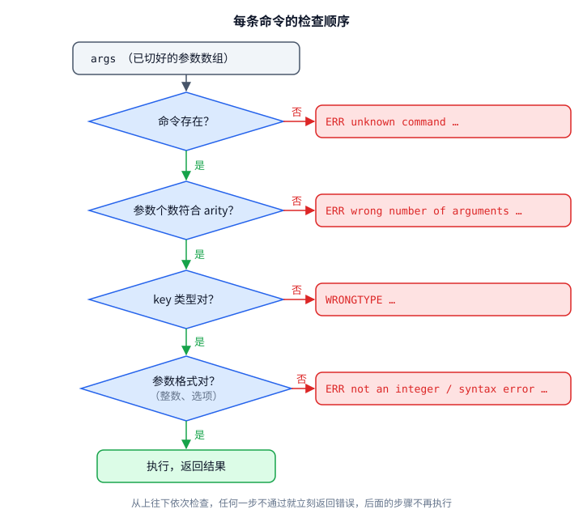

> **大白话：** 命令名不分大小写，数据分大小写；带空格就加引号；先查"有没有这个命令"，再查"参数个数对不对"，再查"类型和格式"，全过了才真正干活。

### 2.3 回复的显示格式

服务端直接返回 redis-cli 屏幕上的样子。一共 6 种，你会写一个 `Reply` 工具类来生成它们。

| 种类 | 显示 | 例子 | 什么时候用 |
|---|---|---|---|
| 状态 | 原样 | `OK`、`PONG`、`string` | 操作成功、TYPE 结果 |
| 字符串 | 加双引号 | `"tom"` | GET 到的值 |
| 空 | `(nil)` | `(nil)` | key 不存在 |
| 整数 | `(integer) ` + 数字 | `(integer) 3` | 计数、长度、TTL |
| 数组 | 编号 + 每行一个字符串 | 见下 | LRANGE、KEYS |
| 错误 | `(error) ` + 错误文本 | `(error) ERR syntax error` | 出错 |

**字符串加引号时要转义**，否则 `"a"b"` 这种显示就乱了：

| 原字符 | 显示成 |
|---|---|
| `"` | `\"` |
| `\` | `\\` |
| 换行 / 回车 / 制表符 | `\n` / `\r` / `\t` |
| 其他 ASCII 控制字符（码值 < 32 或 = 127） | `\x` + 两位十六进制，如 `\x01` |

例：值是 `say "hi"`，显示为 `"say \"hi\""`。

**数组的显示**：编号从 1 开始，编号右对齐，宽度取最大编号的位数。

```
3 个元素：              12 个元素：
1) "a"                  1) "a"
2) "b"                  2) "b"
3) "c"                 ...
                        9) "i"
                       10) "j"
                       11) "k"
                       12) "l"
```

注意 12 个元素时，`1)` 前面有一个空格。空数组显示 `(empty array)`。

> **大白话：** 服务端返回什么样，屏幕上就显示什么样，一共 6 种样式。字符串要加引号，里面的特殊字符要转义；列表要编号，编号要右对齐。

### 2.4 通用错误

| 情况 | 回复 |
|---|---|
| 命令不存在 | `(error) ERR unknown command 'foo', with args beginning with: 'a' 'b' ` |
| 参数个数不对 | `(error) ERR wrong number of arguments for 'get' command` |
| key 类型不对 | `(error) WRONGTYPE Operation against a key holding the wrong kind of value` |
| 需要整数但不是 | `(error) ERR value is not an integer or out of range` |
| 选项写错 | `(error) ERR syntax error` |

细节：

- unknown command 里，命令名按用户**原样**输入显示（`foo` 还是 `FOO` 照抄）；后面列出前几个参数，每个参数用单引号包住并**跟一个空格**，所以末尾有一个空格。没有参数时，冒号后面就是一个空格结尾：`... with args beginning with: `。
- wrong number of arguments 里，命令名一律**小写**。
- WRONGTYPE 开头没有 `ERR`，这是 Redis 的特例。

**"是整数"的判定**比 Java 的 `Long.parseLong` 严格，必须自己写校验。规则：可选一个负号，然后是不以 0 开头的十进制数字（单独的 `0` 除外），且在 `long` 范围内。

| 输入 | Redis 认吗 | `Long.parseLong` 认吗 |
|---|---|---|
| `42`、`-7`、`0` | 认 | 认 |
| `+1` | 不认 | 认 |
| `01`、`-0` | 不认 | 认 |
| ` 1`（带空格）、`1.0`、`abc`、空串 | 不认 | 不认 |
| `9223372036854775808`（超出 long） | 不认 | 不认（抛异常） |

> **大白话：** 报错文字要和真 Redis 一个字都不差，包括末尾的空格。判断"是不是整数"要比 Java 自带的更挑剔：`+1`、`01` 都不算。

---

## 3. 命令详解

这一节是你写代码时最常翻的部分。每个命令都按同样的结构写：

| 小标题 | 回答的问题 |
|---|---|
| 作用 | 这个命令干什么，真实项目里拿它做什么 |
| 格式和参数 | 怎么写，每个参数是什么意思、什么类型、有什么限制 |
| 返回值 | 各种情况下分别返回什么 |
| 错误 | 什么情况报什么错，文案逐字照抄 |
| 示例 | 可以直接拿去和真 Redis 对照 |
| 实现步骤 | 按什么顺序检查、按什么顺序做（顺序取自 Redis 7.2 源码） |
| 写不写 AOF | `isWrite()` 返回什么 |
| 测试要点 | 最容易漏的情况 |

**怎么读格式：** `SET key value [NX | XX] [EX seconds]` 里，方括号 `[ ]` 表示可选，竖线 `|` 表示二选一，`...` 表示可以重复多个。大写的是关键字，照原样写（不区分大小写）；小写的是你要填的值。

**arity 回顾：** 参数个数规则，把命令名本身也算进去。`2` 表示恰好 2 个，比如 `GET name`；`-3` 表示至少 3 个，比如 `SET k v` 后面还能跟选项。arity 检查由 `Dispatcher` 统一做（见 5.5），命令里只需要处理"上限"这类 arity 表达不了的规则。

**15 个命令一览：**

| 分组 | 命令 | 一句话 | arity | 写命令 |
|---|---|---|---|---|
| 连接 | PING | 测试服务是否活着 | -1 | 否 |
| 字符串 | SET | 存一个字符串 | -3 | 是 |
| 字符串 | GET | 取一个字符串 | 2 | 否 |
| 字符串 | INCR | 把数字加 1 | 2 | 是 |
| 字符串 | DECR | 把数字减 1 | 2 | 是 |
| 通用 | DEL | 删除 key | -2 | 是 |
| 通用 | EXISTS | 数一数有几个 key 存在 | -2 | 否 |
| 通用 | EXPIRE | 设置过期时间 | -3 | 是 |
| 通用 | TTL | 查剩余存活秒数 | 2 | 否 |
| 通用 | TYPE | 查值的类型 | 2 | 否 |
| 通用 | KEYS | 按通配符列出 key | 2 | 否 |
| 列表 | LPUSH | 从左边（头）放入 | -3 | 是 |
| 列表 | RPUSH | 从右边（尾）放入 | -3 | 是 |
| 列表 | LPOP | 从左边（头）取出 | -2 | 是 |
| 列表 | LRANGE | 查看一段元素 | 4 | 否 |

> **大白话：** 每个命令都按"干什么、怎么写、返回什么、错了报什么、按什么顺序写代码"来讲。照着"实现步骤"一步步写，再照着"示例"写测试，基本不会跑偏。

### 3.1 PING：测试服务是否活着

**作用**

客户端发 PING，服务端回 PONG，相当于打电话时问一句"喂，在吗"。真实项目里，连接池用它检查连接是否还能用，运维脚本用它判断 Redis 有没有挂。它不读也不改任何数据。

**格式和参数**

```
PING [message]
```

| 参数 | 必填 | 含义 |
|---|---|---|
| message | 否 | 任意字符串。带了就原样返回它，不带就返回 PONG |

arity -1（至少 1 个，也就是命令名本身）。上限 2 个要在命令里自己检查。

**返回值**

| 情况 | 返回 | 回复种类 |
|---|---|---|
| 不带参数 | `PONG` | 状态（不带引号） |
| 带 message | `"message 的内容"` | 字符串（带引号） |

**错误**

| 情况 | 回复 |
|---|---|
| 参数超过 1 个 | `(error) ERR wrong number of arguments for 'ping' command` |

**示例**

```
> PING
PONG
> ping
PONG
> PING hello
"hello"
> PING "hello world"
"hello world"
> PING a b
(error) ERR wrong number of arguments for 'ping' command
```

**实现步骤**

1. `args.length > 2` → 抛 `ArgCountException`。
2. `args.length == 1` → 返回状态 `PONG`。
3. 否则返回字符串 `args[1]`（用 `Reply` 的字符串格式，会加引号、做转义）。

**写不写 AOF：** 不写，`isWrite()` 用默认的 `false`。

**测试要点：** `PONG` 不带引号，`"hello"` 带引号，这两种回复种类不同，最容易写混。

> **大白话：** 问"在吗"，答"在"。带了话就把话原样还给你。超过一句话就报错。

### 3.2 SET：存一个字符串

**作用**

把一个字符串存到某个 key 下。key 已经存在就覆盖。这是最常用的命令，0.4 节里的商品缓存、0.7 节里的验证码都是用它存的。它可以顺带设置过期时间，还能加条件"只有不存在才存"，常用来实现简单的锁：多台机器同时执行 `SET lock 1 NX`，只有一台会成功。

**格式和参数**

```
SET key value [NX | XX] [EX seconds]
```

| 参数 | 必填 | 类型 | 含义 |
|---|---|---|---|
| key | 是 | 字符串 | 要存到哪个 key |
| value | 是 | 字符串 | 要存的值 |
| NX | 否 | 关键字 | Not eXists：key **不存在**时才设置 |
| XX | 否 | 关键字 | key **已存在**时才设置 |
| EX seconds | 否 | 关键字 + 正整数 | 多少秒后过期 |

规则：

- 选项名不区分大小写，顺序任意：`SET k v EX 10 NX` 和 `SET k v NX EX 10` 一样。
- NX 和 XX 不能同时出现。
- 同一个选项可以重复写，不报错。`EX` 写两次时，后面的那个生效（Redis 源码就是这样）。
- 真 Redis 还支持 `PX`、`EXAT`、`PXAT`、`KEEPTTL`、`GET`，本项目不做，遇到时当作不认识的选项，报 `syntax error`。这是和真 Redis 的一处差异。

**返回值**

| 情况 | 返回 |
|---|---|
| 设置成功 | `OK` |
| 带 NX 但 key 已存在，或带 XX 但 key 不存在（没有设置） | `(nil)` |

**错误**

| 情况 | 回复 |
|---|---|
| NX 和 XX 同时出现 | `(error) ERR syntax error` |
| 不认识的选项 | `(error) ERR syntax error` |
| EX 后面没有值（EX 是最后一个参数） | `(error) ERR syntax error` |
| EX 的值不是整数 | `(error) ERR value is not an integer or out of range` |
| EX 的值 ≤ 0，或乘 1000 后溢出，或加上当前时间后溢出 | `(error) ERR invalid expire time in 'set' command` |

注意：SET **不会**报 WRONGTYPE。key 原来是列表也照样覆盖成字符串。

**示例**

```
> SET name tom
OK
> SET name jerry            # 已存在，直接覆盖
OK
> SET name tom NX           # NX：已存在，所以不设置
(nil)
> SET city bj XX            # XX：不存在，所以不设置
(nil)
> SET code 1234 EX 60       # 60 秒后过期
OK
> SET msg "hello world"     # 值里有空格，用引号
OK
> SET k v NX XX
(error) ERR syntax error
> SET k v EX
(error) ERR syntax error
> SET k v EX abc
(error) ERR value is not an integer or out of range
> SET k v EX 0
(error) ERR invalid expire time in 'set' command
> SET k v PX 100            # 本项目不支持 PX
(error) ERR syntax error
```

**实现步骤**（顺序取自 Redis 源码 `setGenericCommand`）

1. **解析选项**：从 `args[3]` 开始循环。
   - 遇到 `NX`：如果已经有 XX，报 syntax error；否则记下 nx = true。
   - 遇到 `XX`：同理，检查有没有 NX。
   - 遇到 `EX`：如果后面没有参数了，报 syntax error；否则记下后一个参数作为秒数字符串，循环下标多跳一格。
   - 其他：报 syntax error。
2. **算过期时刻**（只有带 EX 时）：用严格整数解析秒数，失败报 not an integer。秒数 ≤ 0，或者 `秒数 > Long.MAX_VALUE / 1000`，报 invalid expire time。`expireAt = now() + 秒数 × 1000`，结果 ≤ 0（加法溢出变负数）也报 invalid expire time。
3. **查 key 是否存在**：用 `db.exists(key)`，会顺带处理过期（见 5.4）。
4. **检查条件**：带 NX 且存在，或带 XX 且不存在，返回 `(nil)`，什么都不改。
5. **写入**：`db.set(key, new StringValue(value), expireAt)`。不带 EX 时 expireAt 传 -1，这一步会**清掉原来的过期时间**。
6. 返回 `OK`。

**写不写 AOF：** 写，`isWrite()` 返回 `true`。NX 失败返回 `(nil)` 时也会写进 AOF。重放时它同样什么都不改，结果仍然正确，只是文件多一行（见 5.5）。

**测试要点**

- 覆盖一个列表 key：之后 `TYPE` 应该是 `string`。
- 先 `SET k v EX 100`，再 `SET k v2`：`TTL k` 应该变成 `-1`。
- 先校验选项再看 key：`SET k v NX EX abc`，不管 k 存不存在都报 not an integer。

> **大白话：** 往柜子里放东西，同名的格子就把旧的扔掉。NX 是"空格子才放"，XX 是"已有东西才换"，EX 是"贴一张 N 秒后作废的标签"。不贴标签就把旧标签撕掉。

### 3.3 GET：取一个字符串

**作用**

按 key 取出字符串值，是 0.4 节"先问 Redis"那一步用的命令。

**格式和参数**

```
GET key
```

| 参数 | 必填 | 含义 |
|---|---|---|
| key | 是 | 要读的 key |

arity 2。

**返回值**

| 情况 | 返回 |
|---|---|
| key 存在且是字符串 | `"值"` |
| key 不存在或已过期 | `(nil)` |

**错误**

| 情况 | 回复 |
|---|---|
| key 是列表 | `(error) WRONGTYPE Operation against a key holding the wrong kind of value` |

**示例**

```
> SET name tom
OK
> GET name
"tom"
> GET nobody
(nil)
> RPUSH mylist a
(integer) 1
> GET mylist
(error) WRONGTYPE Operation against a key holding the wrong kind of value
> SET count 10
OK
> GET count                 # 数字也是按字符串存的
"10"
```

**实现步骤**

1. `StringValue v = db.getString(args[1])`。key 不存在返回 null；类型不对时这个方法内部会抛 `WrongTypeException`。
2. `v == null` → 返回 `(nil)`。
3. 否则返回字符串格式的值。

**写不写 AOF：** 不写。

**测试要点：** 过期的 key 返回 `(nil)`（用"拨快时钟"的 `Database` 子类测，见 7.3）；值里有引号或换行时，显示要转义（见 2.3）。

> **大白话：** 按名字取东西。没有就说"没有"，取到的不是字符串就说"类型不对"。

### 3.4 INCR / DECR：把数字加 1 / 减 1

**作用**

把 key 里存的整数加 1（INCR）或减 1（DECR），并返回新值。0.1 节的"浏览数 + 1"就用它：三台 Java 程序同时发 `INCR views:1001`，因为 Redis 是单线程一条一条执行，结果一定准（见 0.5）。也常用来做计数器、限流（"这个 IP 一分钟内请求了几次"）、生成递增 ID。

**格式和参数**

```
INCR key
DECR key
```

| 参数 | 必填 | 含义 |
|---|---|---|
| key | 是 | 存着整数的 key。不存在时当作 0 |

arity 2。

**值是怎么存的：** Redis 没有单独的"整数类型"，整数就是内容恰好是数字的字符串。`SET count 10` 存的是字符串 `"10"`，INCR 时先解析成 `long`，加 1，再转回字符串 `"11"` 存回去。所以 `TYPE count` 是 `string`，`GET count` 得到 `"11"`。

**返回值**

| 情况 | 返回 |
|---|---|
| 成功 | `(integer) 新值` |

**错误**

| 情况 | 回复 |
|---|---|
| key 是列表 | `(error) WRONGTYPE Operation against a key holding the wrong kind of value` |
| 值不是严格整数（见 2.4，如 `abc`、`1.5`、`+1`、`01`） | `(error) ERR value is not an integer or out of range` |
| INCR 时值已经是 `Long.MAX_VALUE`，或 DECR 时已经是 `Long.MIN_VALUE` | `(error) ERR increment or decrement would overflow` |

**示例**

```
> INCR count                # 不存在，当作 0
(integer) 1
> INCR count
(integer) 2
> DECR count
(integer) 1
> GET count
"1"
> DECR newkey               # 不存在，0 - 1
(integer) -1
> SET name tom
OK
> INCR name
(error) ERR value is not an integer or out of range
> SET big 9223372036854775807
OK
> INCR big
(error) ERR increment or decrement would overflow
```

**实现步骤**（INCR 和 DECR 共用一个方法，传入 +1 或 -1）

1. `StringValue v = db.getString(key)`，类型不对会抛 WRONGTYPE。
2. `v == null` → 当前值 = 0；否则用 `Strings.parseLong` 严格解析，失败抛 `NotIntegerException`。
3. **先判断溢出再计算**：INCR 时当前值 == `Long.MAX_VALUE`，或 DECR 时当前值 == `Long.MIN_VALUE`，抛错误。Java 的 `long` 溢出不会报错，会悄悄变成负数，所以必须在加之前判断。
4. 新值转回字符串，存回去，**保留原来的过期时间**（和 SET 相反）。
5. 返回 `(integer) 新值`。

**写不写 AOF：** 写。

**测试要点：** `+1`、`01`、`-0`、` 1` 都要报 not an integer；`SET k 5 EX 100` 后 INCR，TTL 还在。

> **大白话：** 把格子里的数字拿出来加 1 再放回去。格子是空的就当 0。里面不是数字就报错，加爆了也报错。原来的过期标签不动。

### 3.5 DEL：删除 key

**作用**

删除一个或多个 key，不管它是什么类型。真实项目里，MySQL 里的商品信息被修改后，常常顺手 `DEL product:1001`，让下次读取时重新从 MySQL 加载新数据。

**格式和参数**

```
DEL key [key ...]
```

| 参数 | 必填 | 含义 |
|---|---|---|
| key | 是，至少 1 个 | 要删除的 key，可以写多个 |

arity -2。

**返回值**

| 情况 | 返回 |
|---|---|
| 总是 | `(integer) 实际删掉的个数` |

不存在、已过期的 key 不计数。同一个 key 写两次，第二次时它已经被删了，不再计数。

**错误：** 没有自己的错误（参数个数由 Dispatcher 检查）。

**示例**

```
> SET a 1
OK
> SET b 2
OK
> DEL a b nobody
(integer) 2
> SET a 1
OK
> DEL a a
(integer) 1
> DEL nobody
(integer) 0
```

**实现步骤**

1. 计数器 n = 0。
2. 对 `args[1]` 到最后一个参数依次调用 `db.delete(key)`，返回 true 就 n++。`delete` 内部要先处理过期：已过期的 key 当作不存在，返回 false。
3. 返回 `(integer) n`。

**写不写 AOF：** 写。

**测试要点：** 删列表 key；删已过期的 key 返回 0；`DEL a a` 返回 1。

> **大白话：** 把这些格子清空，告诉你实际清了几个。本来就空的不算。

### 3.6 EXISTS：数一数有几个 key 存在

**作用**

判断 key 是否存在。可以一次问多个，返回其中存在的个数。比如注册时先 `EXISTS user:tom`，看用户名有没有被占用。

**格式和参数**

```
EXISTS key [key ...]
```

| 参数 | 必填 | 含义 |
|---|---|---|
| key | 是，至少 1 个 | 要检查的 key |

arity -2。

**返回值**

| 情况 | 返回 |
|---|---|
| 总是 | `(integer) 存在的个数` |

和 DEL 不同：**重复的 key 重复计数**。`EXISTS a a` 在 a 存在时返回 2，因为 EXISTS 不改数据，每次检查都还在。

**示例**

```
> SET name tom
OK
> EXISTS name
(integer) 1
> EXISTS nobody
(integer) 0
> EXISTS name nobody
(integer) 1
> EXISTS name name
(integer) 2
```

**实现步骤**

1. 对每个 key 调用 `db.exists(key)`，为 true 就计数。
2. 返回 `(integer) 计数`。

**写不写 AOF：** 不写。

**测试要点：** 重复 key；已过期的 key 不算；任何类型的 key 都算。

> **大白话：** 点名，到了几个就报几个。同一个名字点两次，人还在，就算两个。

### 3.7 EXPIRE：设置过期时间

**作用**

给一个**已经存在**的 key 设置存活时间，到期后自动消失（见 0.7）。和 `SET ... EX` 的区别是：EXPIRE 不改值，只改过期时间。比如登录态 `session:abc`，用户每操作一次就 `EXPIRE session:abc 1800`，实现"30 分钟不操作自动退出"。

**格式和参数**

```
EXPIRE key seconds
```

| 参数 | 必填 | 类型 | 含义 |
|---|---|---|---|
| key | 是 | 字符串 | 要设置过期的 key |
| seconds | 是 | 整数，可以是负数 | 多少秒后过期。≤ 0 表示立刻过期，也就是马上删除 |

arity -3。真 Redis 7 还支持 `NX`、`XX`、`GT`、`LT` 选项，本项目不做。多出来的参数一律报 `Unsupported option`，这是和真 Redis 的一处差异。

**返回值**

| 情况 | 返回 |
|---|---|
| key 存在，设置成功 | `(integer) 1` |
| key 存在，seconds ≤ 0：直接删除 key | `(integer) 1` |
| key 不存在 | `(integer) 0` |

**错误**

| 情况 | 回复 |
|---|---|
| 有第 3 个及以后的参数 | `(error) ERR Unsupported option 参数原文`，比如 `ERR Unsupported option foo` |
| seconds 不是整数 | `(error) ERR value is not an integer or out of range` |
| seconds × 1000 溢出 `long`，或加上当前时间后溢出 | `(error) ERR invalid expire time in 'expire' command` |

**示例**

```
> SET name tom
OK
> EXPIRE name 60
(integer) 1
> TTL name
(integer) 60
> EXPIRE name 100           # 再次设置，覆盖之前的
(integer) 1
> EXPIRE nobody 60
(integer) 0
> EXPIRE name -1            # 立刻删除
(integer) 1
> EXISTS name
(integer) 0
> EXPIRE name abc
(error) ERR value is not an integer or out of range
> EXPIRE name 60 foo
(error) ERR Unsupported option foo
```

**实现步骤**（顺序取自 Redis 源码 `expireGenericCommand`）

1. `args.length > 3` → 抛错误 `Unsupported option args[3]`。
2. 严格解析 seconds，失败抛 not an integer。注意：这一步在查 key **之前**，所以 key 不存在时，参数写错照样报错。
3. 溢出检查：`seconds > Long.MAX_VALUE / 1000` 或 `seconds < Long.MIN_VALUE / 1000`，报 invalid expire time；否则 `ms = seconds * 1000`。然后 `ms > Long.MAX_VALUE - now()` 也报 invalid expire time；否则 `when = now() + ms`。
4. key 不存在 → 返回 `(integer) 0`。
5. `when <= now()`（seconds ≤ 0 的情况）→ 删除 key，返回 `(integer) 1`。
6. 否则把 Entry 的 expireAt 设为 when，返回 `(integer) 1`。

**写不写 AOF：** 写。原样写入相对秒数，这正是第 9 节的已知缺陷：重启后从重放时刻重新计时。

**测试要点：** 负数秒删除 key；key 不存在但秒数写错，应该报错而不是返回 0。

> **大白话：** 给已有的格子贴一张"N 秒后作废"的标签，重复贴就换新标签。N ≤ 0 就是"现在就作废"，直接清掉。格子不存在就返回 0。

### 3.8 TTL：查剩余存活秒数

**作用**

查一个 key 还剩多少秒过期。比如在页面上显示"验证码 57 秒后失效"，或者排查"这个缓存为什么一直不更新"（结果发现 TTL 是 -1，忘了设过期）。

**格式和参数**

```
TTL key
```

| 参数 | 必填 | 含义 |
|---|---|---|
| key | 是 | 要查的 key |

arity 2。

**返回值**

| 情况 | 返回 |
|---|---|
| key 存在，有过期时间 | `(integer) 剩余秒数` |
| key 存在，没有过期时间（永久有效） | `(integer) -1` |
| key 不存在或已过期 | `(integer) -2` |

剩余秒数 = `(剩余毫秒 + 500) / 1000`，也就是四舍五入到秒。刚 `SET k v EX 10` 后马上 TTL，剩余约 9999 毫秒，(9999 + 500) / 1000 = 10，返回 10 而不是 9。

**示例**

```
> SET code 1234 EX 60
OK
> TTL code
(integer) 60
> SET name tom
OK
> TTL name
(integer) -1
> TTL nobody
(integer) -2
```

**实现步骤**

1. 通过 `db` 查 Entry（会处理过期）。不存在返回 `-2`。
2. `expireAt == -1` 返回 `-1`。
3. `ms = expireAt - now()`，小于 0 时取 0；返回 `(ms + 500) / 1000`。

**写不写 AOF：** 不写。

**测试要点：** 用"拨快时钟"测：设 EX 10，拨快 9400 毫秒，剩 600 毫秒，应返回 1；拨快 9600 毫秒，剩 400 毫秒，应返回 0。

> **大白话：** 看一眼标签还剩几秒。没贴标签说 -1，格子不存在说 -2。

### 3.9 TYPE：查值的类型

**作用**

返回 key 对应值的类型名。主要用于调试，以及在操作前确认类型，避免 WRONGTYPE。

**格式和参数**

```
TYPE key
```

arity 2。

**返回值**

| 情况 | 返回（状态，不带引号） |
|---|---|
| 字符串（包括 INCR 过的数字） | `string` |
| 列表 | `list` |
| 不存在或已过期 | `none` |

**示例**

```
> SET name tom
OK
> TYPE name
string
> INCR count
(integer) 1
> TYPE count
string
> RPUSH l a
(integer) 1
> TYPE l
list
> TYPE nobody
none
```

**实现步骤**

1. 查 Entry（会处理过期）。
2. 不存在返回状态 `none`；否则返回状态 `entry.value.type()`。这里**不要写 if-else 判断类型**，让多态完成（见 5.2）。

**写不写 AOF：** 不写。

> **大白话：** 问"这个格子里装的是什么"，答"字符串""列表"或"空的"。这个答案由值自己报上来，你不用挨个判断。

### 3.10 KEYS：按通配符列出 key

**作用**

列出名字符合某个模式的所有 key，比如 `KEYS user:*` 列出所有用户相关的 key。只适合调试和小数据量。它要遍历整个哈希表，数据多的时候会卡住整个服务，因为 Redis 是单线程（见 4.2）。生产环境一般禁用它，改用 SCAN，本项目不做 SCAN。

**格式和参数**

```
KEYS pattern
```

| 参数 | 必填 | 含义 |
|---|---|---|
| pattern | 是 | glob 通配模式，规则见下表 |

arity 2。

**通配规则**（和 shell 里 `ls *.java` 的写法一样）

| 写法 | 匹配 | 例子 |
|---|---|---|
| `*` | 任意长度的任意字符，包括 0 个 | `h*o` 匹配 `ho`、`hello` |
| `?` | 恰好 1 个任意字符 | `h?llo` 匹配 `hello`、`hallo`，不匹配 `hllo` |
| `[abc]` | 括号里的任意 1 个字符 | `h[ae]llo` 匹配 `hello`、`hallo` |
| `[^a]` | 除 a 以外的任意 1 个字符 | `h[^e]llo` 匹配 `hallo`，不匹配 `hello` |
| `[a-c]` | 范围内的 1 个字符 | `key[0-9]` 匹配 `key3` |
| `\x` | 把 x 当普通字符 | `a\*b` 只匹配 `a*b` |
| 其他字符 | 必须完全相同（区分大小写） | `abc` 只匹配 `abc` |

- **整串匹配**，不是"包含"：`a*` 不匹配 `ba`。
- `[c-a]` 写反了也可以，会自动交换成 `[a-c]`（Redis 源码这样做）。

**返回值**

| 情况 | 返回 |
|---|---|
| 有匹配 | 数组，每个元素是一个 key |
| 没有匹配 | `(empty array)` |

顺序是你的哈希表的遍历顺序，不保证和插入顺序一致。真 Redis 的顺序也不固定，所以对照测试时只比较"有哪些"，不比较顺序。已过期的 key 不返回。

**示例**

```
> SET user:1 tom
OK
> SET user:2 jerry
OK
> SET user:10 spike
OK
> SET name x
OK
> KEYS user:?
1) "user:1"
2) "user:2"
> KEYS user:*
1) "user:1"
2) "user:10"
3) "user:2"
> KEYS user:[12]
1) "user:1"
2) "user:2"
> KEYS *e
1) "name"
> KEYS nothing*
(empty array)
```

**实现步骤**

1. `String[] all = db.keys()`（已经跳过过期的）。
2. 逐个用 `Strings.globMatch(pattern, key)` 判断，匹配的放进结果数组（自己处理数组扩容，或者先数一遍再分配）。
3. 用 `Reply` 格式化成数组回复。

**globMatch 的写法建议：** 用递归 `match(p, pi, s, si)`，表示"模式从 pi 开始、字符串从 si 开始能否匹配"：

- 模式用完了：字符串也用完才算匹配。
- 当前是 `*`：要么 `*` 匹配 0 个字符，试 `match(p, pi+1, s, si)`；要么吃掉一个字符，试 `match(p, pi, s, si+1)`，前提是字符串还没用完。
- 当前是 `?`：字符串没用完就各进一格。
- 当前是 `[`：找到对应的 `]`，逐个检查括号内的字符和范围。
- 当前是 `\`：跳过它，按普通字符比较下一个。
- 其他：字符相等就各进一格。

**写不写 AOF：** 不写。

**测试要点：** `*` 匹配空串（`KEYS a*` 能匹配 `a`）；`a*` 不匹配 `ba`；`?` 不匹配空；`[^...]`；`\*`。

> **大白话：** 按"名字长得像什么样"把格子找出来。`*` 是"随便多少个字"，`?` 是"随便一个字"，`[...]` 是"这几个字里挑一个"。必须从头到尾都对得上。

### 3.11 列表命令的共同背景

列表是一串**有顺序**的字符串，两头都能放、都能取。左边叫"头"（head，下标 0），右边叫"尾"（tail）。命令名里的 L 和 R 就是 Left 和 Right。

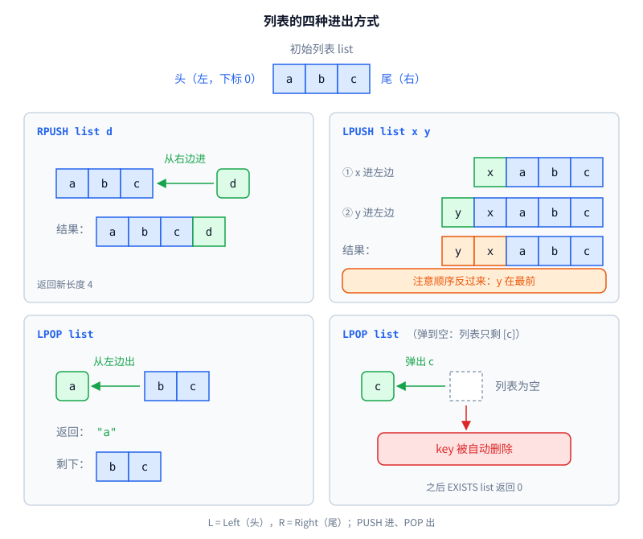

两条所有列表命令都遵守的规则：

1. **不存在"空列表"。** 往不存在的 key 里 PUSH，会自动新建列表；列表被 POP 空后，key 自动删除，之后 `EXISTS` 返回 0，`TYPE` 返回 `none`。
2. **列表命令碰到字符串 key 报 WRONGTYPE**，反过来也一样。

> **大白话：** 列表就是一排格子，左边是头、右边是尾。PUSH 是往两头塞，POP 是从头上拿。拿空了这个 key 就没了。

### 3.12 LPUSH / RPUSH：从左边 / 右边放入

**作用**

往列表的头部（LPUSH）或尾部（RPUSH）放入一个或多个元素。典型用法：

- "最新 N 条"：新消息 `LPUSH`，最新的永远在下标 0，再用 `LRANGE 0 9` 取最新 10 条（见 0.8）。
- 简单的任务队列：生产者 `RPUSH` 放到队尾，消费者 `LPOP` 从队头取，先进先出。

**格式和参数**

```
LPUSH key element [element ...]
RPUSH key element [element ...]
```

| 参数 | 必填 | 含义 |
|---|---|---|
| key | 是 | 列表的 key。不存在就新建 |
| element | 是，至少 1 个 | 要放入的元素，可以写多个，**从左到右依次**放入 |

arity -3。

**多个元素的顺序**（最容易错）：

- `RPUSH l a b c`：依次放到尾部，结果 `[a, b, c]`，顺序和你写的一样。
- `LPUSH l a b c`：先把 a 放到头部，再把 b 放到 a 前面，再把 c 放到 b 前面，结果 `[c, b, a]`，**顺序是反的**。

**返回值**

| 情况 | 返回 |
|---|---|
| 成功 | `(integer) 放入之后的列表长度` |

**错误**

| 情况 | 回复 |
|---|---|
| key 是字符串 | `(error) WRONGTYPE Operation against a key holding the wrong kind of value` |

**示例**

```
> RPUSH list a b c
(integer) 3
> LPUSH list x y
(integer) 5
> LRANGE list 0 -1
1) "y"
2) "x"
3) "a"
4) "b"
5) "c"
> SET name tom
OK
> LPUSH name z
(error) WRONGTYPE Operation against a key holding the wrong kind of value
```

**实现步骤**（两个命令共用一个方法，传入"放头还是放尾"）

1. `ListValue lv = db.getList(key)`，类型不对会抛 WRONGTYPE。
2. `lv == null` → 新建一个 `ListValue`，用 `db.set(key, lv, -1)` 存进去。
3. 对 `args[2]` 到最后一个参数依次调用 `addFirst` 或 `addLast`。
4. 返回 `(integer) lv.size()`。

**写不写 AOF：** 写。

**测试要点：** LPUSH 多个元素的顺序；对已有列表 PUSH 时**保留**原来的过期时间（PUSH 只改值，不动 expireAt）；`MyList` 扩容时数据不丢。

> **大白话：** RPUSH 是排队排到队尾，LPUSH 是插队插到最前面。一次插好几个，就是一个接一个插到最前面，所以最后插的站在第一个。

### 3.13 LPOP：从左边取出

**作用**

从列表头部取出（并删除）元素，返回取出的内容。配合 RPUSH 就是一个先进先出的队列：生产者 RPUSH 放任务，消费者 LPOP 取任务。

**格式和参数**

```
LPOP key [count]
```

| 参数 | 必填 | 类型 | 含义 |
|---|---|---|---|
| key | 是 | 字符串 | 列表的 key |
| count | 否 | 非负整数 | 一次取几个。不写就取 1 个 |

arity -2。上限 3 个（命令名 + key + count）要在命令里自己检查。

**返回值**：带不带 count，返回格式不同，这是最容易错的地方。

| 情况 | 不带 count | 带 count |
|---|---|---|
| key 不存在 | `(nil)` | `(nil)` |
| 正常 | 字符串 `"a"` | 数组 `1) "a"`，**哪怕只取了 1 个也是数组** |
| count = 0（key 存在） | — | `(empty array)` |
| count 超过长度 | — | 有多少取多少 |

取空后 key 自动删除。

**错误**

| 情况 | 回复 |
|---|---|
| 参数超过 3 个 | `(error) ERR wrong number of arguments for 'lpop' command` |
| count 不是整数 | `(error) ERR value is not an integer or out of range` |
| count 是负数 | `(error) ERR value is out of range, must be positive` |
| key 是字符串 | `(error) WRONGTYPE Operation against a key holding the wrong kind of value` |

**示例**

```
> RPUSH list a b c d e
(integer) 5
> LPOP list
"a"
> LPOP list 1               # 带 count，即使 1 个也是数组
1) "b"
> LPOP list 2
1) "c"
2) "d"
> LPOP list 10              # 超过长度，有多少取多少
1) "e"
> EXISTS list               # 取空了，key 自动删除
(integer) 0
> LPOP list
(nil)
> LPOP list 2
(nil)
> RPUSH list x
(integer) 1
> LPOP list 0
(empty array)
> LPOP list -1
(error) ERR value is out of range, must be positive
> LPOP list 1 2
(error) ERR wrong number of arguments for 'lpop' command
```

**实现步骤**（顺序取自 Redis 源码 `popGenericCommand`）

1. `args.length > 3` → 抛 `ArgCountException`。
2. 如果带 count：严格解析，失败报 not an integer；小于 0 报 must be positive。注意：这一步在查 key **之前**，key 不存在时 count 写错照样报错。
3. `ListValue lv = db.getList(key)`。为 null 返回 `(nil)`；类型不对抛 WRONGTYPE。
4. 带 count 且 count == 0 → 返回 `(empty array)`。
5. 不带 count：`removeFirst()` 一个，返回字符串。
6. 带 count：取 `min(count, size)` 个，依次 `removeFirst()` 放进数组，返回数组。
7. 如果 `lv.size() == 0`，`db.delete(key)`。

**写不写 AOF：** 写。

**测试要点：** 带 count = 1 时返回数组；取空后 `TYPE` 是 `none`；key 不存在时 `LPOP k -1` 也要报错。

> **大白话：** 从队头往外拿人。不说拿几个就拿一个、直接给你；说了拿几个，就装在一个"名单"里给你，哪怕只有一个。队伍拿空了，这个 key 就没了。

### 3.14 LRANGE：查看一段元素

**作用**

查看列表中某个下标区间的元素，**不删除**。最常用的写法是 `LRANGE key 0 -1` 查看全部，以及 `LRANGE key 0 9` 取前 10 个（"最新 10 条评论"）。

**格式和参数**

```
LRANGE key start stop
```

| 参数 | 必填 | 类型 | 含义 |
|---|---|---|---|
| key | 是 | 字符串 | 列表的 key |
| start | 是 | 整数，可以为负 | 起始下标（包含） |
| stop | 是 | 整数，可以为负 | 结束下标（**包含**，和 Java 的 `substring` 不同） |

arity 4。

**下标的两种数法：** 正数从头数（0 是第一个），负数从尾数（-1 是最后一个）。

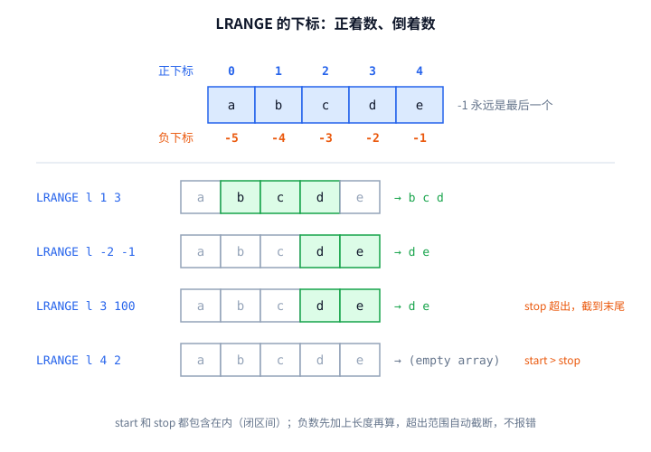

**返回值**

| 情况 | 返回 |
|---|---|
| 区间内有元素 | 数组 |
| 区间为空，或 key 不存在 | `(empty array)` |

下标超出范围**不报错**，会自动截断。

**错误**

| 情况 | 回复 |
|---|---|
| start 或 stop 不是整数 | `(error) ERR value is not an integer or out of range` |
| key 是字符串 | `(error) WRONGTYPE Operation against a key holding the wrong kind of value` |

**示例**（列表为 `[a, b, c, d, e]`）

```
> LRANGE l 0 -1
1) "a"
2) "b"
3) "c"
4) "d"
5) "e"
> LRANGE l 1 3
1) "b"
2) "c"
3) "d"
> LRANGE l -2 -1
1) "d"
2) "e"
> LRANGE l 3 100
1) "d"
2) "e"
> LRANGE l -100 1
1) "a"
2) "b"
> LRANGE l 4 2
(empty array)
> LRANGE l 10 20
(empty array)
> LRANGE nobody 0 -1
(empty array)
```

**实现步骤**（取自 Redis 源码 `lrangeCommand` 和 `addListRangeReply`）

1. 严格解析 start 和 stop，失败报 not an integer。这一步在查 key 之前。
2. `ListValue lv = db.getList(key)`。为 null 返回 `(empty array)`；类型不对抛 WRONGTYPE。
3. 规整下标，`len = lv.size()`：
   1. `start < 0` 则 `start += len`；`stop < 0` 则 `stop += len`。
   2. 加完 `start` 还是负数，就设为 0。
   3. `start > stop` 或 `start >= len` → 返回 `(empty array)`。
   4. `stop >= len` 则 `stop = len - 1`。
4. 把下标 start 到 stop（两端都含）的元素放进数组返回。

**写不写 AOF：** 不写。

**测试要点：** 把上面每个示例都写成测试；特别注意 `-100 1` 和 `4 2`。

> **大白话：** 看一排格子里第几个到第几个，两头都算。负数是倒着数。超出范围就截到边上，不报错；一个都没有就说"空"。

---

## 4. 整体架构

### 4.1 分层和数据流

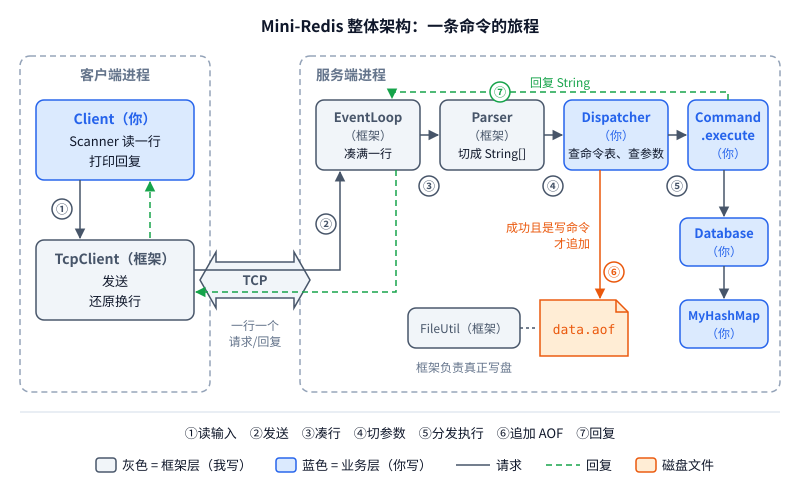

一条命令的完整旅程，以 `SET msg "hi there"` 为例：

1. 客户端 `Scanner` 读到 `SET msg "hi there"`，交给 `TcpClient.send`。
2. 框架把这一行加上换行发出去。
3. 服务端事件循环收到字节，凑够一整行（遇到 `\n`），交给 `Parser.parse`，得到 `{"SET", "msg", "hi there"}`。
4. 你的 `Dispatcher` 按 `args[0]` 找到 `SetCommand`，检查参数个数，调用 `execute`，返回 `"OK"`。
5. 因为执行成功且 `SetCommand.isWrite()` 为真，`Dispatcher` 让 `Aof` 追加一行 `SET msg "hi there"`。
6. 框架把 `"OK"` 转义（这里没有换行，不变）发回。
7. 客户端还原转义，打印 `OK`。

> **大白话：** 一条命令从客户端出发，经过网络到服务端，被切成参数、找到对应的命令、执行、需要的话记到本子上，再把结果原路送回去。灰色的管道是我铺的，蓝色的房间是你盖的。

### 4.2 为什么是单线程事件循环

Redis 只用一个线程执行所有命令。它不是靠"一个连接一个线程 + 锁"，而是用 epoll 让一个线程同时盯住所有连接：

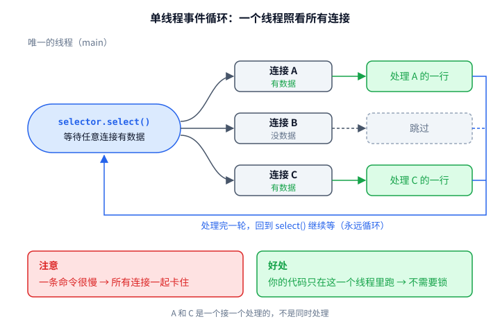

对你的意义：**你写的所有代码都只在这一个线程里运行**，`MyHashMap`、过期检查、AOF 追加都不需要任何同步。这不是靠锁"串行化"出来的，是真正只有一个线程。

代价也和 Redis 一样：一个命令跑得慢，所有客户端都卡住。所以 `KEYS *` 在大数据量时要慎用，阻塞类命令（如 `BLPOP`）在这个模型下做不了，直接不在范围内。

Java NIO 和 epoll 的对照（框架内部用，你不用写）：

| C++（epoll） | Java NIO |
|---|---|
| `epoll_create` | `Selector.open()` |
| `epoll_ctl(ADD, fd, EPOLLIN)` | `channel.register(selector, OP_READ)` |
| `epoll_wait` | `selector.select()` |
| 非阻塞 fd | `channel.configureBlocking(false)` |
| 每连接读缓冲，处理半包 | 每连接挂一个缓冲区，凑满一行才交出去 |

> **大白话：** 一个服务员照看所有桌子：哪桌喊了就去哪桌，一次只服务一桌。你写的代码永远只有这一个服务员在跑，所以不用担心两个人同时改数据。代价是某一桌磨蹭太久，其他桌都得等。

### 4.3 线路协议（框架负责，你只需知道）

请求和回复都是**一行**，以 `\n` 结尾。回复里如果有真正的换行（数组回复），框架会转义：

| 回复里的原字符 | 线路上传输 |
|---|---|
| `\`（反斜杠） | `\\` |
| 换行 | `\n`（反斜杠 + 字母 n） |

客户端收到后反向还原。例子：你的 `LRANGE` 返回

```
1) "a"
2) "b"
```

线路上实际是一行 `1) "a"\n2) "b"`，客户端还原后打印成两行。用 nc 连时你看到的就是转义后的那一行。

**注意一个容易混淆的点**：2.3 节里字符串加引号时也会把换行显示成 `\n`。那是**你的** `Reply` 做的显示转义（值里的换行），这里是**框架**做的传输转义（回复里的换行）。两层各管各的，互不影响。比如值是 `a换行b`：

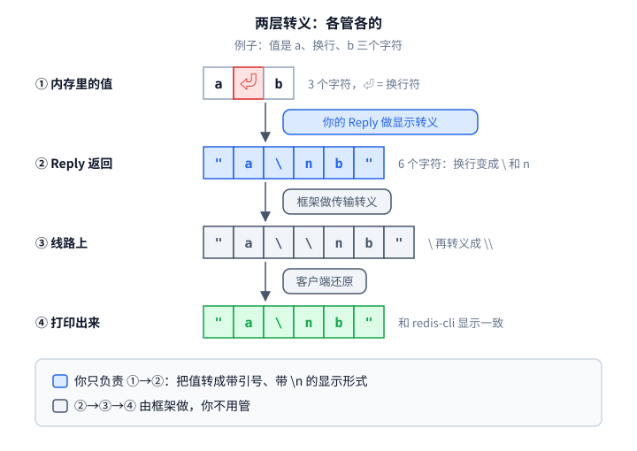

> **大白话：** 网络上一次只能传"一行"，所以回复里的换行要先变成 `\n` 两个字符，到了客户端再变回来，这件事框架做。你只管把值显示成 redis-cli 的样子。

---

## 5. 模块设计

### 5.1 目录和分工

```
mini-redis/
├── src/redis/
│   ├── net/            ← 框架层（我写，你只调用）
│   │   ├── EventLoop.java        NIO 事件循环、半包拼行、传输转义
│   │   ├── TcpClient.java        客户端连接，send() 一问一答
│   │   ├── Parser.java           引号解析 parse()，以及反向的 join()
│   │   ├── FileUtil.java         appendLine / readAll
│   │   └── RequestHandler.java   接口：String handle(String[] args)
│   │
│   ├── Server.java               main：重放 AOF，启动 EventLoop
│   ├── Client.java               main：交互式客户端
│   ├── Dispatcher.java           命令表、参数个数检查、调用、落盘
│   ├── Database.java             对外的增删查 + 过期检查
│   ├── MyHashMap.java            手写哈希表
│   ├── MyList.java               手写动态数组（List 类型的底层）
│   ├── Entry.java                一个 key 的完整信息
│   ├── Value.java                抽象类：值
│   ├── StringValue.java
│   ├── ListValue.java
│   ├── Reply.java                6 种回复的格式化
│   ├── Strings.java              严格整数解析、glob 匹配
│   ├── Aof.java                  追加、重放、坏行处理
│   ├── command/                  15 个命令，每个一个类
│   │   ├── Command.java          抽象类
│   │   └── SetCommand.java ...
│   └── error/                    异常体系
│       └── RedisException.java ...
└── test/redis/                   JUnit 测试
```

框架给你的全部 API 就这几个：

```java
public interface RequestHandler {
    String handle(String[] args);     // 返回 redis-cli 显示格式的回复，可含换行
}

EventLoop.start(int port, RequestHandler h);     // 阻塞运行；引号不配对等协议错误由框架直接回复
TcpClient c = new TcpClient(String host, int port);
String reply = c.send(String line);              // 已还原换行
c.close();
String[] args = Parser.parse(String line);       // 引号不配对抛 IllegalArgumentException
String line  = Parser.join(String[] args);       // 反向：需要时自动加引号，parse(join(a)) 等于 a
FileUtil.appendLine(String path, String line);   // 追加一行并 flush
String  text = FileUtil.readAll(String path);    // 文件不存在返回 null
FileUtil.writeAll(String path, String text);     // 覆盖写整个文件（截掉 AOF 半行时用）
```

`readAll` 返回整个文件内容而不是按行切好的数组，是有意的：你需要自己判断"最后一行有没有换行结尾"（见 5.7），这一步交给你来 `split`。

> **大白话：** `net/` 文件夹是我的，其他全是你的。我只给你 5 个工具：起服务、连服务、切参数、写文件、读文件。

### 5.2 数据模型：Entry 和 Value

一个 key 在内存里长这样：

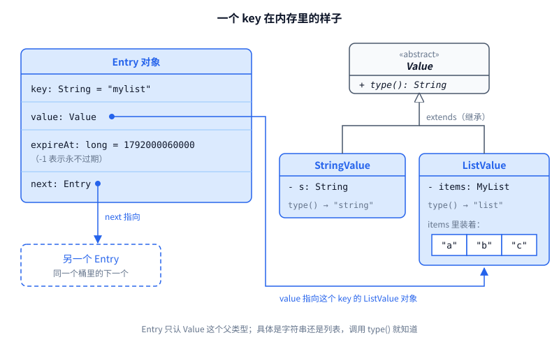

值的类型用继承表达，见上图右半部分。

为什么这样设计：

- **TYPE 命令不需要 if-else**：直接 `return entry.value.type()`。这就是多态的价值：调用方不知道也不关心具体是哪种值。
- **WRONGTYPE 检查集中到一处**：`Database` 提供 `getString(key)` 和 `getList(key)`，内部用 `instanceof` 判断，不对就抛 `WrongTypeException`。15 个命令里不再到处写类型判断。
- **INCR 不需要第三个子类**：Redis 里整数就是字符串，`StringValue` 存 `"42"`，INCR 时解析再写回。少一个类，符合奥卡姆剃刀。

`expireAt` 存绝对时间而不是剩余秒数，因为剩余秒数每时每刻在变，绝对时间只在 EXPIRE / SET 时写一次。用 `long` 是因为毫秒时间戳约 1.8×10¹²，超出 `int` 范围（约 2.1×10⁹）。

**MyList** 是一个只存 `String` 的动态数组，因为不能用 `ArrayList`。LPUSH 需要在头部插入，最简单的做法是整体后移一位，O(n)，对练习足够。需要的方法：`addFirst`、`addLast`、`removeFirst`、`get(i)`、`size()`，满了就用 `Arrays.copyOf` 扩成 2 倍。

> **大白话：** 每个 key 是一张卡片，上面写着名字、装的东西、过期时间，还有一根线连着同一格里的下一张卡片。装的东西分"字符串"和"列表"两种，它们都是 Value 的孩子，各自会报自己的类型名。

### 5.3 手写哈希表 MyHashMap

拉链法，结构和 JDK 的 HashMap（Java 8 之前）一样：

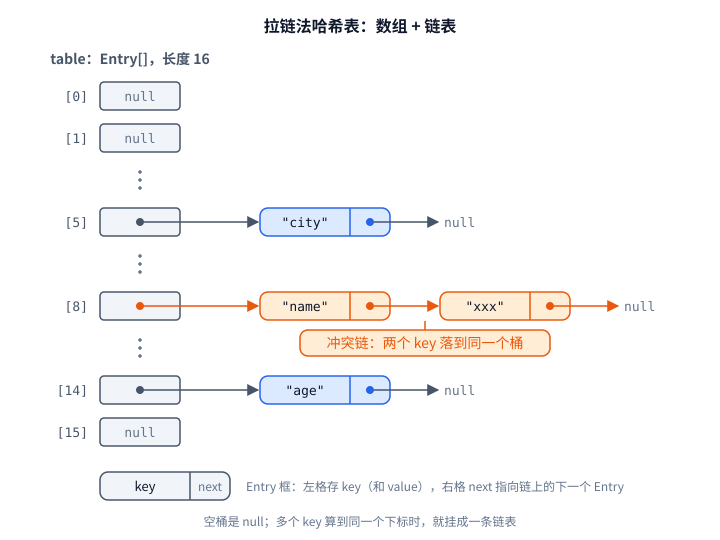

**参数**

| 项 | 值 | 原因 |
|---|---|---|
| 初始桶数 | 16 | 和 JDK 一样 |
| 桶数 | 永远是 2 的幂 | 这样 `h % cap` 可以写成 `h & (cap - 1)`，位运算更快，而且结果永远非负 |
| 负载因子 | 0.75 | `size > cap * 0.75` 时扩容，即 16 个桶存到第 13 个时扩 |
| 扩容 | 桶数翻倍，所有元素 rehash | 一次性搬完；Redis 是渐进式搬，见第 9 节 |
| 缩容 | 不做 | 奥卡姆剃刀 |

**桶下标怎么算**

```
h     = key.hashCode()       // String 自带：s[0]*31^(n-1) + ... + s[n-1]
h     = h ^ (h >>> 16)       // 扰动：把高 16 位混进低 16 位
index = h & (cap - 1)        // 取低几位
```

为什么要扰动：`cap = 16` 时 `& 15` 只看最低 4 位，高位完全浪费。如果很多 key 的 hashCode 只在高位不同，就会全挤进同一个桶。`>>>` 是**无符号**右移，左边补 0；`>>` 是算术右移，补符号位。这里必须用 `>>>`，这是 Java 比 C++ 多出来的运算符（C++ 对 `unsigned` 用 `>>` 就行，Java 没有无符号整数）。

实际算一遍（数字已用程序验证）：

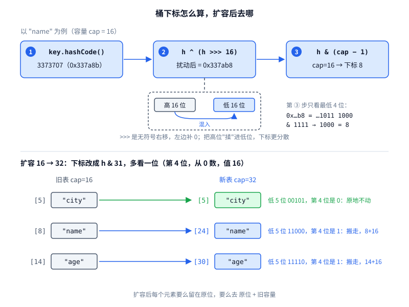

| key | hashCode | 扰动后（十六进制） | `& 15`（cap=16） | `& 31`（cap=32） |
|---|---|---|---|---|
| `"name"` | 3373707 | `0x337ab8` | 8 | 24 |
| `"age"` | 96511 | `0x178fe` | 14 | 30 |
| `"city"` | 3053931 | `0x2e9945` | 5 | 5 |

扩容到 32 后，每个元素要么留在原位，要么移到"原位 + 16"，取决于扰动后 hash 的第 4 位（值为 16 的那一位）是 0 还是 1。`name` 和 `age` 这一位是 1，搬走了；`city` 是 0，没动。写完 rehash 可以用这张表做测试。

**要实现的方法**

```
Entry get(String key)            找不到返回 null
void  put(String key, Entry e)   已存在则替换，否则插到链表头；插完检查是否扩容
boolean remove(String key)       删除成功返回 true
int   size()
String[] keys()                  遍历所有桶、所有链，收集 key（KEYS 命令用）
```

链表删除是最容易写错的地方：删的是链头时要改 `table[i]`，删的是中间节点时要改前一个节点的 `next`。测试要覆盖"删头、删中、删尾、删唯一一个"四种。

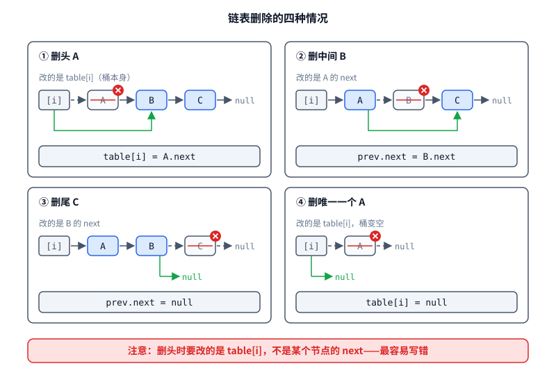

> **大白话：** 一排 16 个抽屉。用 key 算出一个数，决定放进哪个抽屉；两个 key 算到同一个抽屉，就用线串起来。东西多到抽屉装得太挤（超过 75%），就换一排两倍大的抽屉，全部重新放一遍。删东西时，删第一个要改抽屉本身，删后面的要改前一个的线。

### 5.4 Database 和惰性过期

`Database` 包住 `MyHashMap`，是命令访问数据的唯一入口。命令类不能直接碰 `MyHashMap`，这是封装。

**惰性删除**：不开定时器扫描，只在访问时检查。所有读 key 的路径都先经过同一个私有方法：

```
private Entry lookup(String key):
    e = map.get(key)
    if e == null:                         return null
    if e.expireAt != -1 且 now >= e.expireAt:
        map.remove(key)                   // 顺手删掉
        return null                       // 当作不存在
    return e
```

时间线示例：

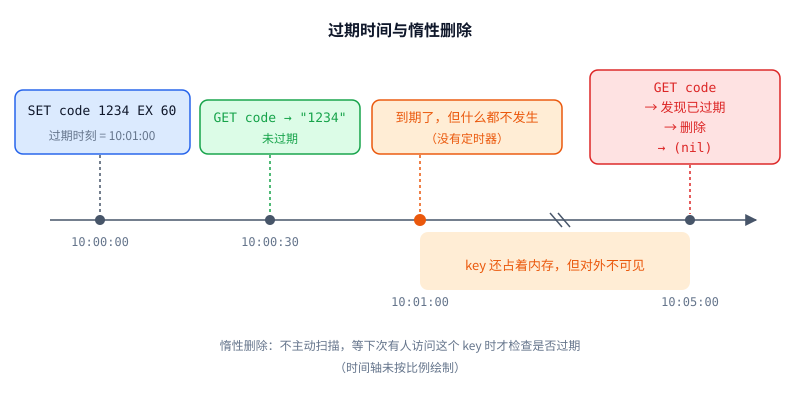

10:01 到 10:05 之间，这个 key 其实还占着内存，只是对外不可见。KEYS 遍历时也要逐个检查过期，跳过并删除过期的。

**对外方法**（建议，可以按需增减）：

```
Entry       lookup(String key)            私有，见上
StringValue getString(String key)         不存在返回 null；不是 string 抛 WrongTypeException
ListValue   getList(String key)           同上，针对 list
void        set(String key, Value v, long expireAt)
boolean     delete(String key)
boolean     exists(String key)
String[]    keys()                        已过期的不返回
long        now()                         System.currentTimeMillis()，单独包一层
```

`now()` 单独包一层，是为了测试：测试里可以写一个子类重写 `now()` 返回固定时间，这样测过期不用真的 `sleep` 60 秒。这又是一处继承 + 重写的用法。

> **大白话：** 所有命令都只能通过 Database 拿数据。过期的 key 不会到点自动消失，而是等有人来拿时，Database 看一眼标签发现过期了，才把它扔掉，假装从来没有过。

### 5.5 Command 抽象类和 Dispatcher

```java
public abstract class Command {
    public abstract String name();                // 小写，如 "set"
    public abstract int arity();                  // 见术语表
    public boolean isWrite() { return false; }    // 写命令的子类重写成 true
    public abstract String execute(Database db, String[] args) throws RedisException;
}
```

每个命令一个子类，例如 `GetCommand`：`name()` 返回 `"get"`，`arity()` 返回 2，`execute` 里调 `db.getString(args[1])`，再用 `Reply` 格式化。

**命令表**：`Dispatcher` 里放一个 `Command[]`，启动时把 15 个命令 new 进去。查找时遍历数组，用 `equalsIgnoreCase` 比较名字。15 个元素线性查找足够快；也可以复用你的 `MyHashMap`，但它存的是 `Entry`，不合适，不必强求。

**分发流程**，也是 `RequestHandler.handle` 的实现：

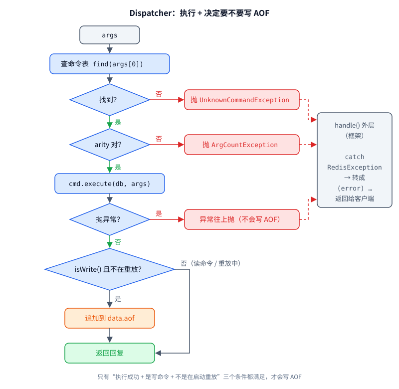

```
dispatch(args, replaying):
    if args.length == 0:                      return ""          // 空行
    cmd = find(args[0])
    if cmd == null:                           抛 UnknownCommandException
    检查 arity：
        n = cmd.arity()
        n > 0 且 args.length != n   → 抛 ArgCountException
        n < 0 且 args.length < -n   → 抛 ArgCountException
    reply = cmd.execute(db, args)             // 失败就抛异常，不会往下走
    if cmd.isWrite() 且 !replaying:
        aof.append(args)
    return reply
```

`handle()` 里调 `dispatch(args, false)`，并 catch `RedisException`，把它转成 `(error) ...` 返回。**异常不能漏到框架里**，否则一个错误命令就会断开这个客户端的连接。

两个细节：

- **"失败的写命令不落盘"是自动的**：`execute` 抛异常就直接跳出，走不到 `aof.append`。
- **"没改数据的写命令"会落盘**：比如 `SET k v NX` 而 k 已存在、`DEL nobody`。这样重放结果依然正确（重放时同样什么都不改），只是文件多几行，接受。

> **大白话：** 每个命令是一个类，都会回答四个问题：我叫什么、要几个参数、是不是写命令、怎么执行。Dispatcher 是前台：查名字、点人数、叫人干活；干成了而且是写操作，就记到本子上。出错了不慌，统一包装成 `(error) ...` 回给客户。

### 5.6 异常体系

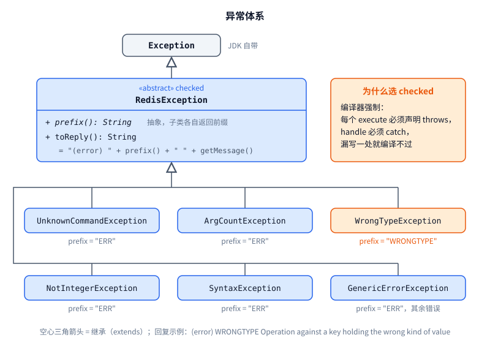

选 **checked**（继承 `Exception` 而不是 `RuntimeException`）是有意的：编译器会强制每个 `execute` 声明 `throws RedisException`，也强制 `handle` 必须 catch。你在 C++ 里没有这种机制，这是 Java 异常最值得体会的特性。

`toReply()` 放在父类，子类只提供 `prefix()` 和消息，这是模板方法模式：公共流程在父类，可变的部分留给子类。

> **大白话：** 每种错误一个异常类，都继承同一个父类。父类负责把错误拼成 `(error) ...` 这句话，子类只说"我是 ERR 还是 WRONGTYPE"。用 checked 异常，是让编译器盯着你：哪里可能出错、哪里必须接住，漏了就编译不过。

### 5.7 AOF：追加和重放

**追加**：`aof.append(args)` 调 `Parser.join(args)` 把参数拼回一行再写。不直接存用户原始输入，是因为原始输入可能大小写混杂、多余空格；拼回来的格式统一，而且 `join` 保证带空格、引号的值能被 `parse` 原样还原。

```
用户输入：   set   msg   "hi there"
落盘：       set msg "hi there"
```

**重放**发生在 `Server.main` 里、启动 `EventLoop` 之前，此时还没有客户端连进来：

```
text = FileUtil.readAll("data.aof")
if text == null:  空库启动
lines = text.split("\n", -1)      // -1：保留末尾的空串，不能省
```

`split` 默认会丢掉末尾的空串，加 `-1` 才保留。用它判断文件是否以换行结尾：

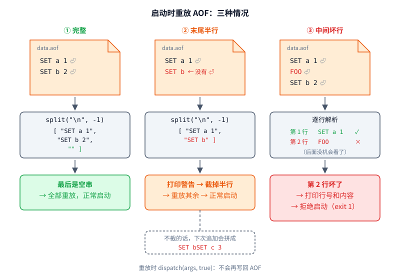

**坏行处理，和 Redis 一致**：

| 情况 | Redis 的做法 | 本项目 |
|---|---|---|
| 只有最后一行没换行结尾（写到一半断电） | 默认 `aof-load-truncated yes`：警告，把文件截掉这半行，继续启动 | 打印警告；用 `writeAll` 把文件改写成去掉半行后的内容；正常启动 |
| 中间某一行坏了 | 拒绝启动，提示用 `redis-check-aof --fix` | 打印行号和内容，`System.exit(1)`；修复工具不做，手动删掉那行 |

"坏了"指：`Parser.parse` 抛异常、命令不存在、参数个数不对，或 `execute` 抛异常。

截掉半行这一步不能省：不截的话，下一次 `appendLine` 会把新命令接在半行后面，变成一行 `SET bSET c 3`，下次启动就成了中间坏行，拒绝启动。

**重放时要关掉追加**：调 `dispatch(args, true)`。否则重放 100 行又写回 100 行，文件每重启一次翻一倍。

> **大白话：** 平时每做成一件写操作，就在本子末尾记一行。重启时先读本子：最后一行没写完，就撕掉那半行接着用；中间有一行看不懂，就拒绝开张，等你手动修。照本子重做的时候，别再往本子上记。

---

### 5.8 Client：模仿 redis-cli

```
$ java -cp out redis.Client                  # 默认连 127.0.0.1:6380
$ java -cp out redis.Client -h 127.0.0.1 -p 6380
127.0.0.1:6380> SET a 1
OK
127.0.0.1:6380> quit
$
```

规则：

- 提示符是 `host:port> `，用 `printf` 输出，不换行。
- 读到空行就重新显示提示符，不发送。
- 输入 `quit` 或 `exit`（不区分大小写）就关闭连接、退出程序，不发送给服务端。
- 读到输入结束（Ctrl-D，`Scanner.hasNextLine()` 返回 false）也退出。
- 服务端断开时，`send` 会抛 `IOException`，打印 `Could not connect to Redis at 127.0.0.1:6380: Connection refused` 然后退出。
- 命令行参数 `-h host`、`-p port` 自己解析 `main` 的 `args`；参数不认识就打印用法退出。

你的客户端**连不了真 Redis**，因为真 Redis 用的是 RESP 二进制安全协议，不是一行文本。要对照，就另开一个终端用真的 `redis-cli -p 6379`，同样的命令两边各敲一遍，比较输出。

> **大白话：** 做一个长得像 redis-cli 的小程序：显示提示符、读一行、发出去、打印结果，输入 quit 就退出。

---

## 6. 实现步骤

分 5 步，每步结束都能运行、都有测试通过。不要跳步。


### 第 1 步：跑通链路（覆盖知识点 1、2、4、5）

- 用我给的框架，写 `Server.main`：启动 `EventLoop`，`handle` 先只认 `PING`，其余返回 unknown command。
- 写 `Client`：提示符、读行、发送、打印、quit。
- **完成标准**：终端 A 起服务，终端 B 跑客户端，`PING` 返回 `PONG`；`nc` 也能连上。

### 第 2 步：手写数据结构（覆盖 3、6）

- `MyHashMap`、`MyList`、`Entry`。
- 先只写 JUnit 测试，不接服务端。
- **完成标准**：`MyHashMapTest` 覆盖增删查、冲突链删头/中/尾、插入 1000 个后全部能查到、扩容后 5.3 表里的桶下标对得上；`MyListTest` 覆盖头插、尾插、扩容。

### 第 3 步：类型体系和命令（覆盖 7、8）

- `Value` / `StringValue` / `ListValue`、`Database`、`Command`、`Dispatcher`、`Reply`。
- 15 个命令先实现正常路径，错误一律先返回一个简单字符串占位。
- **完成标准**：第 2、3 节所有正常情况的示例都能复现。

### 第 4 步：异常和严格校验（覆盖 9、10）

- 异常体系、`Strings.parseLong`（严格版）、`Strings.globMatch`、`Reply` 的字符串转义、数组编号对齐。
- 把第 3 步的占位全部换成抛异常。
- **完成标准**：第 2、3 节所有错误示例逐字一致，包括 unknown command 末尾的空格。

### 第 5 步：过期和持久化

- `EXPIRE`、`TTL`、惰性删除、`Aof`、启动重放、坏行处理。
- **完成标准**：写入一些数据 → `Ctrl-C` 杀服务 → 重启 → 数据还在；手动在 AOF 末尾删掉换行符 → 重启后警告并截断；手动在中间插一行 `FOO` → 重启后报行号并退出。

> **大白话：** 先让最简单的 PING 跑通，再造数据结构，再加命令，再抠错误细节，最后做过期和持久化。每一步都能跑起来再走下一步，出错时好定位。
---

## 7. 测试：JUnit 5

### 7.1 只需要会这些

```java
import org.junit.jupiter.api.*;
import static org.junit.jupiter.api.Assertions.*;

class GetCommandTest {
    Dispatcher d;

    @BeforeEach                                   // 每个 @Test 运行前都执行一次，保证测试互不干扰
    void setUp() { d = new Dispatcher(new Database()); }

    @Test
    void getMissingKey() {
        assertEquals("(nil)", d.handle(new String[]{"GET", "nobody"}));
    }

    @Test
    void getOnListThrows() throws Exception {
        d.handle(new String[]{"RPUSH", "l", "a"});
        assertThrows(WrongTypeException.class,
                     () -> d.dispatch(new String[]{"GET", "l"}, false));
    }
}
```

| JUnit | GoogleTest |
|---|---|
| `@Test` 方法 | `TEST(Suite, Name)` |
| `@BeforeEach` | fixture 的 `SetUp()` |
| `assertEquals(期望, 实际)` | `EXPECT_EQ(期望, 实际)` |
| `assertTrue(x)` / `assertNull(x)` | `EXPECT_TRUE(x)` |
| `assertThrows(类型.class, () -> ...)` | `EXPECT_THROW(..., 类型)` |

`() -> ...` 是 lambda，这里只需要会照抄这个写法：把会抛异常的代码包进去，交给 JUnit 去执行和捕获。注意 `assertEquals` 的参数顺序是**先期望、后实际**，写反了失败信息会颠倒。

### 7.2 怎么跑

两种方式选一种：

**IntelliJ IDEA**：在测试类里写 `@Test`，`import` 那行标红时按 Alt+Enter，选"Add JUnit 5 to classpath"。之后点方法左边的绿色三角就能运行。

**纯命令行**：下载一个独立 jar（JUnit 官方提供的 console-standalone，Maven Central 上当前版本 6.1.3，需要 JDK 17+；用 JDK 8/11 就改用 1.14.4）：

```
lib/junit-platform-console-standalone-6.1.3.jar
```

```
javac -d out $(find src -name "*.java")
javac -d out-test -cp out:lib/junit-platform-console-standalone-6.1.3.jar $(find test -name "*.java")
java -jar lib/junit-platform-console-standalone-6.1.3.jar \
     --class-path out:out-test --scan-class-path
```

### 7.3 测什么

| 测试类 | 重点 |
|---|---|
| `MyHashMapTest` | 链表删除四种情况；扩容后数据不丢；5.3 表里的下标 |
| `MyListTest` | 头插顺序；扩容 |
| `StringsTest` | 2.4 严格整数表的每一行；3.10 glob 表的每一行，外加 `*` 匹配空串、`a*` 不匹配 `ba` |
| `ReplyTest` | 引号转义；`\x01`；数组 9 个和 10 个元素的对齐差别；空数组 |
| 每个命令一个 `XxxCommandTest` | 第 3 节每个示例照抄成一个断言 |
| `ExpireTest` | 用重写了 `now()` 的 `Database` 子类，"拨快时钟"测过期，不用 sleep |
| `AofTest` | 完整文件、末尾半行、中间坏行三种；重放后文件行数不变 |

第 3 节的示例就是现成的测试用例：每个 `> 命令` 加下面的输出，就是一行 `assertEquals`。

> **大白话：** JUnit 就是"自动对答案"：你写好"输入什么、应该得到什么"，它帮你跑一遍，对不上就标红。第 3 节的每个示例都能直接抄成一条测试。

---

## 8. 知识点对照表

写完之后用这张表自查，每一格都应该能在自己的代码里指出来。

| # | 知识点 | 在哪练 |
|---|---|---|
| 1 | 数据类型和变量 | `long expireAt`（为什么不能用 int）；INCR 溢出判断；`>>>` 与 `>>`；`int` 桶下标 |
| 2 | 输入输出 | Client 的 `Scanner` 读行、`printf` 提示符；`hasNextLine()` 处理 Ctrl-D |
| 3 | 数组 | `Entry[] table`、`MyList` 的 `String[]`、`Command[]` 命令表、`Arrays.copyOf` 扩容、`main` 的 `args` |
| 4 | 方法 | 每个命令一个 `execute`；`Database` 的增删查；递归的 `globMatch` |
| 5 | 分支循环 | 分发流程；冲突链遍历；SET 选项解析循环；AOF 重放循环；LRANGE 下标规整 |
| 6 | 类和对象基础 | `Entry`、`Database`、`MyHashMap` 的构造器、`this`、`private` 字段；`Reply` / `Strings` 的 `static` 工具方法 |
| 7 | 三大特性 | 封装：`Database` 是唯一入口，`MyHashMap` 内部不外露。继承：`Value` 体系、`RedisException` 体系、测试用的 `Database` 子类。多态：`value.type()`、`cmd.execute()`、`cmd.isWrite()`、`e.prefix()` |
| 8 | 抽象类和接口 | 抽象类：`Value`、`Command`、`RedisException`。接口：`RequestHandler`（你实现、框架调用，即回调） |
| 9 | String 三兄弟 | `equalsIgnoreCase`、`toLowerCase`、`charAt`、`split(…, -1)`；`StringBuilder` 拼数组回复和转义；`String.format("%" + w + "d) ", i)` 做编号对齐。附加实验：分别用 `String +=` 和 `StringBuilder` 拼 10 万次，`System.nanoTime()` 计时对比；`StringBuffer` 换成 `StringBuilder` 再比一次，体会同步的开销 |
| 10 | 异常 | 自定义 checked 异常体系；`throws` 声明；`handle` 统一 catch 转错误回复；`IOException` 处理；`assertThrows` |

> **大白话：** 写完后拿这张表对一对，10 个知识点每个都应该能在代码里指出具体位置。
---

## 9. 和真 Redis 的差异（已知缺陷）

这些是有意的简化，不是 bug。写测试时遇到不一致，先查这张表。

| 方面 | 真 Redis | 本项目 | 影响 |
|---|---|---|---|
| 线路协议 | RESP，二进制安全 | 一行文本 + 换行转义 | 不能和真 redis-cli 互连；值里不能有任意二进制 |
| AOF 里的 EXPIRE | 改写成 `PEXPIREAT` 绝对时间 | 原样写入相对秒数 | **重启后 TTL 从重放时刻重新计时**，本该过期的 key 会多活一段 |
| 过期删除 | 惰性 + 每秒约 10 次的定期抽样 | 只有惰性 | 没人访问的过期 key 一直占内存 |
| 哈希表扩容 | 渐进式 rehash，每次操作搬一点 | 一次性搬完 | 数据量大时扩容那一下会卡顿 |
| AOF 刷盘 | `appendfsync everysec`，每秒 fsync | 每行 flush，不 fsync | 进程崩溃不丢；机器断电可能丢最近几条 |
| AOF 重写 | `BGREWRITEAOF` 压缩文件 | 不做 | 文件只增不减 |
| AOF 修复 | `redis-check-aof --fix` | 不做，手动删行 | — |
| 命令范围 | 200+ | 15 个，SET/EXPIRE 选项有删减 | 见第 3 节各命令的"不做"说明 |
| 多数据库 | `SELECT 0~15` | 只有一个库 | — |
| List 底层 | quicklist，头尾 O(1) | 数组，头插 O(n) | 只影响性能 |
| 字符串长度 | 按字节 | 按 Java 的 `char` | 中文等非 ASCII 字符的 `\x` 转义和真 Redis 不同 |

> **大白话：** 这些地方是故意做简单的，不是 bug。最要紧的一条：带过期时间的 key，重启后会重新计时。
---

## 10. 分工小结

| 我（框架层） | 你（业务层） |
|---|---|
| `EventLoop`：NIO 事件循环、半包拼行、传输转义、写缓冲 | `Server.main`、`Client` |
| `TcpClient` | `Dispatcher`、15 个 `Command` |
| `Parser`：引号解析与 `join` | `Database`、`MyHashMap`、`MyList`、`Entry`、`Value` 体系 |
| `FileUtil` | `Reply`、`Strings`、`Aof`、异常体系 |
| `RequestHandler` 接口 | 全部 JUnit 测试 |

下一步：我先交付框架层 5 个文件和第 1 步的空骨架，你从第 1 步开始写。

> **大白话：** 网络和文件我来，其余全是你的。
